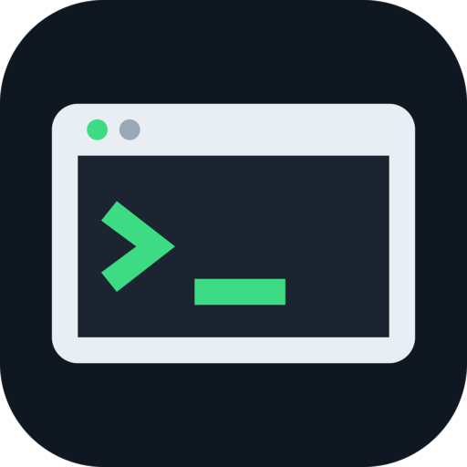
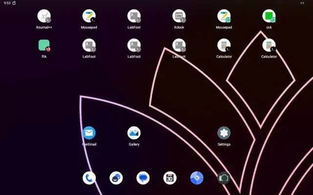
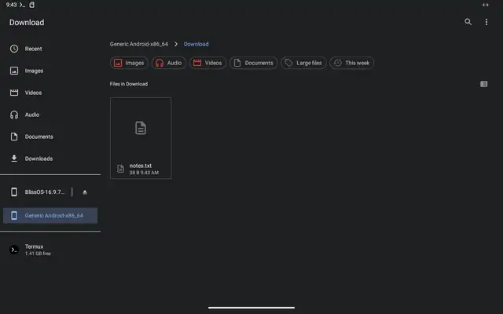
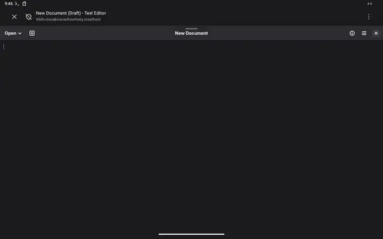
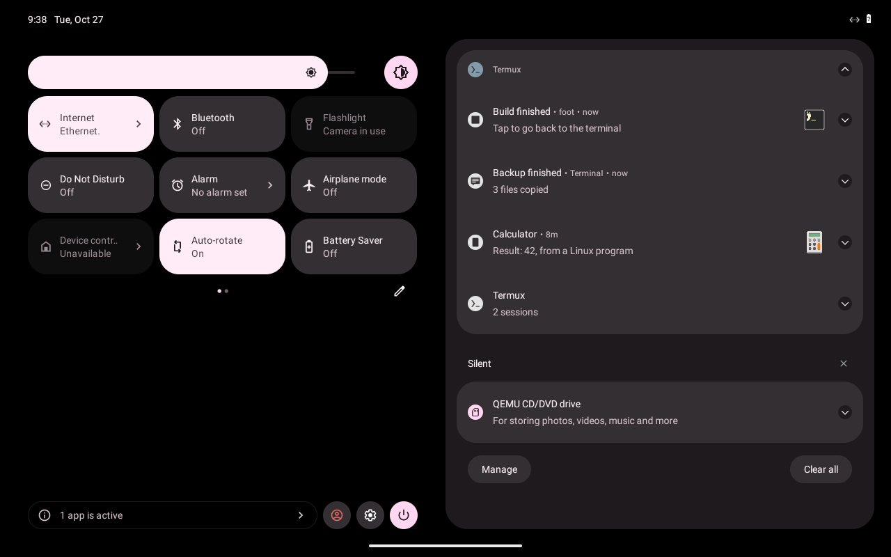
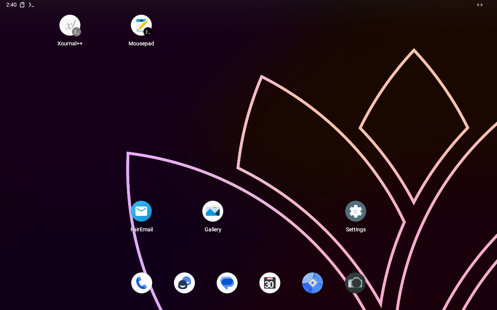
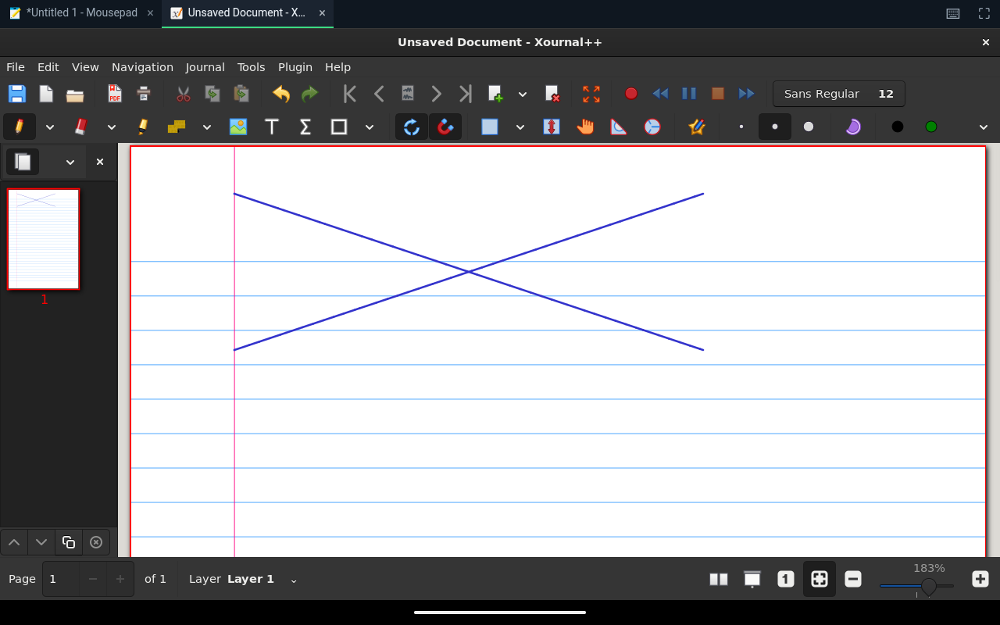

<p align="center"></p>

<h1 align="center">Lindroids</h1>

<p align="center"><b>Linux apps on Android, each in a window of its own.</b><br>
Run Linux GUI programs from Termux, a proot distro or Flathub, with a home screen icon, Android's
theme, notifications and files. One package in Termux; the window is the phone's browser, or an
optional small window app of ours that needs no browser. No permission, no root.</p>

<p align="center"><a href="https://discord.gg/aWQwxV4wm"></a></p>

<p align="center"><br>
<sub>The home screen icon, with Termux closed: GNOME Calculator (Flathub) opens in its own window, in Android's dark theme and accent colour, and closes with it. <a href="media/demos/launch-from-home.mp4">mp4</a></sub></p>

<table>
<tr>
<td align="center"><br><sub>A file from Android's Files app, <b>Open with → Termux</b>: it opens in a Linux editor (Mousepad). <a href="media/demos/open-with.mp4">mp4</a></sub></td>
<td align="center"><br><sub><b>Open…</b> in a Linux program (GNOME Text Editor) is Android's own picker: Files, or a photo from the Camera. <a href="media/demos/file-picker.mp4">mp4</a></sub></td>
</tr>
<tr>
<td align="center"><br><sub>Linux programs' notifications are Android notifications, with their name and icon; a tap brings back the program's window</sub></td>
<td align="center"><br><sub><code>lindroids export</code>: home screen icons with the programs' own icons</sub></td>
</tr>
<tr>
<td align="center"><br><sub>Xournal++ from a proot-distro Debian, drawn with the pen</sub></td>
<td align="center"><br><sub>A running program keeps its icon in the status bar; its notification brings its window back. <a href="media/demos/running-icon.mp4">mp4</a></sub></td>
</tr>
</table>

```sh
lindroids run org.gnome.Calculator     # a window of its own
lindroids export org.gnome.Calculator  # a home screen icon; works with Termux closed, after a reboot
```

## What you get

- **A window per program**, full screen from the first tap: the program's name, icon, menus,
  dialogs. Closing the window ends the program; the program ending ends the window. While it
  runs, its icon is in the status bar.
- **Any Linux program with a window**: Termux packages, programs in a proot distro, **Flatpaks**
  from Flathub (in Termux itself: `install.sh` sets Flatpak up there, no root), X11 programs.
- **Home screen icons** (`lindroids export`) that start the program even when Termux is closed or
  the phone just restarted.
- **A window without a browser** (optional): `lindroids app install` adds one small APK
  (`org.lindroids`) that shows the page in Android's own WebView, full screen from the start, with
  the program's name and icon in Recents, no Google or Samsung server involved, and Android's file
  pickers, clipboard and share. `lindroids config browser app` (or `export --browser app`) uses it;
  without it, everything stays in the browser as before. See
  [BROWSER_AGNOSTIC_APK.md](BROWSER_AGNOSTIC_APK.md).
- **Android's side, piped in**: dark mode and accent colour; files (Android's picker for
  *Open…* and *Save As…*, *Open with* from the Files app, the Camera as a photo source; in
  Chromium-based browsers saves go back into the picked file and folders can be picked);
  notifications in Android's shade; links open in Android's browser; clipboard both ways; sound;
  the microphone; keeping the screen on (for a video or a presentation); battery and battery
  saver; touch, pen, soft and hardware keyboards; network state.

## How it works, and why

- **Programs and their data stay in the container** — Termux, a proot distro, a Flatpak.
  **Everything outside it comes from Android**: files, folders, the theme, notifications,
  hardware. Linux programs never get the device; Android stays in charge of it.
- **The window is the phone's browser.** Android only draws windows for installed apps, so with
  no app of our own, a browser is the one that can show them. Termux opens each program as a
  *Custom Tab* in a task of its own — one entry in Recents per program, no tabs, no address bar —
  through a small `app_process` helper that runs as Termux and needs no permission. The same
  helper pins the home screen icons and posts notifications, so they belong to Termux.
- **The server** (`lindroids`, one Rust binary) is a Wayland compositor and a PulseAudio server.
  It serves the window page on a loopback port, sends the 64×64 tiles that changed (LZ4), and
  takes back touch, keys and text. Both ends prove themselves with P-256 keys before anything is
  shown. Android's state reaches programs through the standard desktop portals (Settings,
  FileChooser, OpenURI, Notification, Inhibit), so GTK and libadwaita programs follow it unchanged.
- **Files from Android**: *Open with → Termux* runs `~/bin/termux-file-editor`, which Lindroids
  installs; it picks the Linux program for the file's type (`lindroids open --linux`).

```
 Termux / proot distro / Flatpak                         Android
 ┌────────────────────────────────────┐                  ┌─────────────────────────────────┐
 │ Linux programs                     │  WebSocket on    │ a browser Custom Tab per program│
 │   │ Wayland │ PulseAudio │ X11     │◀═ loopback ═════▶│  canvas, touch, keys, sound     │
 │ lindroids server + desktop portals │  (P-256 keys)    │  file picker, clipboard, theme  │
 │ app_process helper (as Termux) ────┼─────────────────▶│ home screen icons, notifications│
 └────────────────────────────────────┘                  └─────────────────────────────────┘
```

Details and the experiments behind them: [docs/DISPLAY.md](docs/DISPLAY.md),
[docs/ARCHITECTURE.md](docs/ARCHITECTURE.md). What is checked, and how: [lab/CHECKLIST.md](lab/CHECKLIST.md).

## Limits

- With the optional window app (`config browser app`), the browser limits below do not apply: it
  is our own WebView activity, full screen before the first touch. Without it, windows open in a
  Chromium-based browser (Chrome, Edge, Brave, Samsung Internet, Cromite…)
  whatever the default browser is: there Recents shows the program's icon, and the window
  closes when the program ends. A browser that opens an ordinary tab instead of a window (Cromite
  without *Allow custom tab intents*) is passed over. With only Firefox, the window shows
  Firefox's icon in Recents and an ended program's window asks for one tap on ✕: Firefox gives a
  page no way to set either, and nothing outside it can close its window.
- Full screen starts on the first tap: browsers allow it only then.
- Files in Firefox: a picked file reaches the program as a copy, *Save As* goes to Downloads, and
  there is no folder picker. Chromium-based browsers (Chrome 132+, Edge, Brave, Cromite) have
  File System Access: saves go into the picked file or where *Save As* says, and folders can be
  picked (copied to Linux, changes and new files written back; deletions are not).
- Home screen icons carry Termux's badge (the launcher draws it on every app's shortcut), and
  `lindroids remove` can only grey one out (Android lets only the launcher unpin).
- Exports become apps of their own where Chrome (with Google Play services) or Samsung Internet (on
  a Samsung phone with the Galaxy Store) installs a WebAPK: choosing **Install app** (not **Add to
  Home screen**) gives the program's icon, with no Termux badge. A Samsung tablet with Chrome did
  install a WebAPK for Lindroids' local `http://<label>.localhost` pages on 2026-10-29; a shortcut
  path makes only a shortcut, which the export now rejects. See [docs/WEBAPK.md](docs/WEBAPK.md).

## Install

In **Termux** (from F-Droid or GitHub):

```sh
curl -fsSL https://dixonsolutions.github.io/lindroids/install.sh | sh
```

[`install.sh`](install.sh) adds the Lindroids repository to the package manager that is there
(Termux's APT or pacman; Debian/Ubuntu, Arch, Fedora, openSUSE, Alpine, Void in proot distros and
on desktops), so the usual upgrade keeps it current, and offers to set up Flatpak.
Details: [docs/INSTALL.md](docs/INSTALL.md). Nothing to pair: the first window carries a one-time
ticket.

## Use

```sh
lindroids run <command> [args]           # run a program in a window of its own
lindroids run org.gnome.TextEditor       # a Flatpak
lindroids run flatpak run <app> [args]   # the same (on Android without bubblewrap, which needs root)
lindroids run --prootdistro=debian gedit # from a proot-distro distro (found without it, too)
lindroids run xterm                      # X11 programs too

lindroids export <command> [args]        # home screen icon (again: updates it)
lindroids export <command>               # an app of its own where Chrome or Samsung Internet can make one
lindroids config browser default         # or webapk (the default), app, or a browser's package
lindroids app install                    # the optional window app (no browser)
lindroids export --browser app <program> # an icon whose windows use it
lindroids list | remove <id> | launch <id>

lindroids open --linux <file>            # open a file in a Linux program (--with, --choose, --list)
lindroids open <file|URL>                # open in Android
lindroids notify <title> [body]          # an Android notification
lindroids info                           # what Android says: dark mode, network, battery…
lindroids setup [x11|flatpak] | status | doctor | pair | stop | version
```

`LINDROIDS_SCALE=2` sets the output scale, `LINDROIDS_TOUCH=pointer` makes touch a mouse,
`LINDROIDS_BROWSER=<package>` picks the browser for windows, `LINDROIDS_STATS=1` (when the
server starts) shows the frame rate in the window.

## Tested

Android 13 lab VM (SELinux enforcing, Termux 0.118.3, Firefox): GNOME Calculator and Text Editor
from Flathub, Mousepad and foot from Termux, Xournal++ from Debian, xclock (X11); home screen
icons with Termux closed and after a reboot; Open with, the file picker, notifications, theme;
55 fps scrolling. The window app (b16): one full-screen task, Back kept, the program ending removed
it, the offline page, and the bridge's clipboard, save and read (`lab/test-window-app.sh`). See
[lab/CHECKLIST.md](lab/CHECKLIST.md) and [docs/TESTING.md](docs/TESTING.md).

## Build from source

```sh
scripts/build-release.sh   # CLIs for 8 targets, packages, tarballs, the APK → dist/
packaging/build-webview-apk.sh --version 0.1.0 --out target/apk-test --debug-sign
cargo test --workspace
```

Needs Rust with the Android and musl targets, `cargo-ndk` and NDK 27: [docs/PACKAGING.md](docs/PACKAGING.md).

## License

[MIT](LICENSE-MIT) or [Apache-2.0](LICENSE-APACHE), at your option. Packages also ship
xwayland-satellite (MPL-2.0): [third_party/README.md](third_party/README.md).
