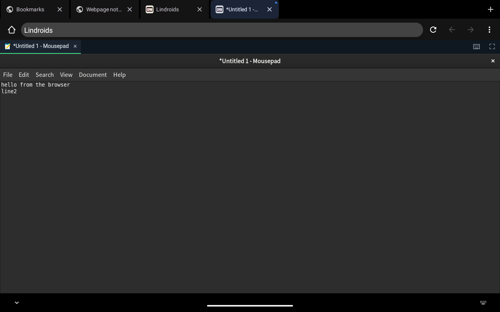
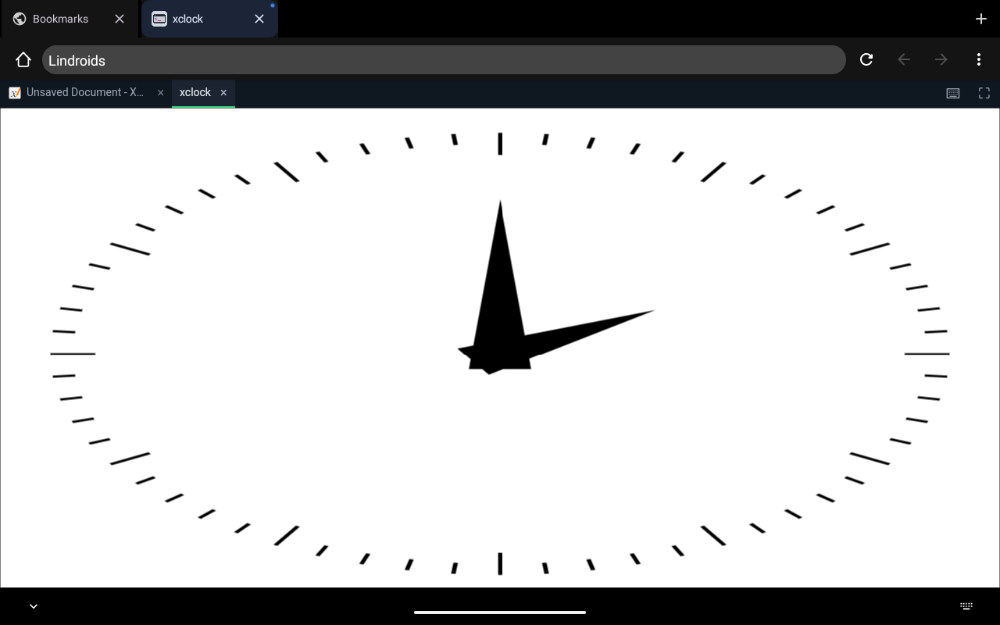
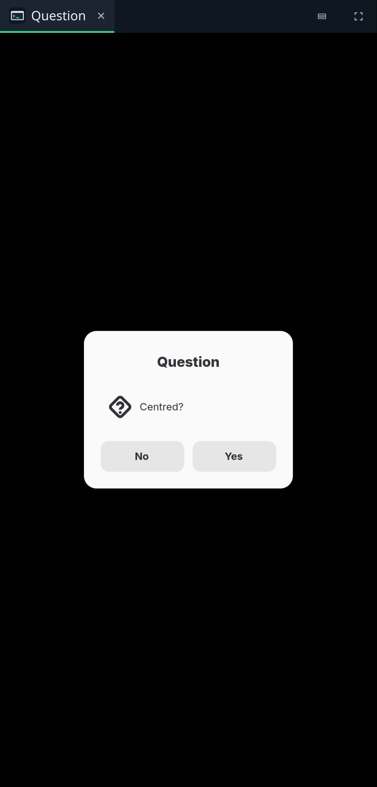

<p align="center"></p>

<h1 align="center">Lindroids</h1>

<p align="center"><b>Linux apps on Android, in the browser you already have.</b><br>
Run any Linux GUI program from Termux, a proot distro or Flatpak, and its windows show in the
phone's web browser — with touch, the pen, the keyboard, sound and the clipboard. One package,
installed with Termux's own package manager. No app to install, no permission to grant, no root.</p>

```sh
lindroids run mousepad            # its window opens in the browser
lindroids export xournalpp        # a home screen icon that starts it, Termux open or not
```

<table>
<tr>
<td align="center"><br><sub>Mousepad (GTK 3) from Termux, typed into on Android 13</sub></td>
<td align="center"><br><sub>Xournal++ from a proot-distro Debian, drawn with the pen</sub></td>
</tr>
<tr>
<td align="center"><br><sub>X11: <code>lindroids run xclock</code>, a tab next to Xournal++</sub></td>
<td align="center"><br><sub>A GTK 4 dialog on a phone-sized screen</sub></td>
</tr>
<tr>
<td align="center" colspan="2"><br><sub><code>lindroids export</code>: shortcuts owned by Termux (Xournal++ greyed out after <code>lindroids remove</code>)</sub></td>
</tr>
</table>

## What it does

- **Every Linux window is a tab of one page.** `lindroids run` starts the program and brings the
  Lindroids page to the front of the browser (`http://127.0.0.1:<port>/`, served by lindroids
  itself). Menus, popups and dialogs work; small dialogs are centred, and windows that insist on
  being larger than the screen are scaled down to fit. The ⛶ button makes it full screen.
- **Anything with a window.** Native Termux packages (GTK, Qt, SDL, foot, mpv…), programs in a
  proot distro (found there without `--distro`), **Flatpaks** from Flathub — in Termux itself,
  with no root and no distro: `install.sh` builds Flatpak natively for Termux (Android patches in
  `packaging/termux-flatpak`); apps install with `flatpak --user install` and run under proot —
  and **X11 programs** with no option needed (rootless Xwayland through
  [xwayland-satellite](https://github.com/Supreeeme/xwayland-satellite); `lindroids setup x11`
  installs what is missing).
- **Input.** Touch (as touch, or as a mouse for programs that don't do touch), the **pen** (as a
  mouse with its button held, so it draws in note and paint programs), mouse and wheel, hardware
  keyboards, and the soft keyboard (⌨, or by itself when a text field takes focus).
- **Sound.** A PulseAudio-compatible server plays every stream in the page (Web Audio): paplay,
  GStreamer, SDL, ALSA via pulse, libcanberra. The browser starts sound after the first tap.
- **Android's side of the desktop**, through the standard desktop portal and notification service
  on the programs' own session bus: dark mode, opening links (`xdg-open`, `lindroids open`),
  files to open or save through the browser, notifications shown in the page, network state. The
  clipboard goes both ways.
- **Apps of their own.** Every exported program has its own page (`/app/<id>`), named and
  iconed after it, with an **Install** button: installed, it opens standalone — no address bar,
  no tabs, its own icon and Recents entry — and starts its program while Lindroids runs.
- **Home screen icons.** `lindroids export <command>` pins a shortcut with the program's own
  name and icon (Android asks first). It belongs to Termux, not to an app of ours: tapping it
  has Termux run the program — Termux is started if it is closed — and its windows show in the
  browser. The program stays where it is installed (Termux, a proot-distro distro, a Flatpak);
  nothing is copied.
- **Pure Rust** — the compositor, the sound server, the CLI, the frame transport — plus one
  small web page and a 7 KB Java helper that asks Android for shortcuts.

## Install

In **Termux** (from F-Droid or GitHub):

```sh
curl -fsSL https://dixonsolutions.github.io/lindroids/install.sh -o install.sh && sh install.sh
lindroids run mousepad
```

The installer is [`install.sh`](install.sh) in this repository (the same file is served from the
site above and from `https://raw.githubusercontent.com/dixonSolutions/lindroids/main/install.sh`).
It adds the Lindroids repository to the package manager that is there and installs with it, so
the usual upgrade keeps it current: in **Termux** (APT, or pacman with Termux's pacman bootstrap —
into Termux itself, no extra distro), and in the distros of proot-distro, UserLAnd, Andronix and
desktop Linux — **Debian/Ubuntu/Kali** (APT), **Arch/Manjaro/Artix** (pacman),
**Fedora/RHEL/Rocky/Alma** (dnf), **openSUSE** (zypper), **Alpine/postmarketOS/Chimera** (apk) and
**Void** (xbps). Anywhere else it installs a static binary.
Details: [docs/INSTALL.md](docs/INSTALL.md).

Nothing else to set up: the page `lindroids run` opens carries the pairing secret in its `#`
part, which never leaves the browser. A page opened by hand asks once for the code that
`lindroids pair` shows.

## Use

```sh
lindroids run <command> [args]          # run a program; its windows show in the browser
lindroids run "foot -e htop"            # a whole command line
lindroids run --prootdistro=debian gedit   # from a proot-distro distro (found without it, too)
lindroids run org.gnome.Calculator      # an installed Flatpak (in Termux or any distro)
lindroids run xterm                     # X11 programs too
lindroids run --x11 gedit               # a toolkit app on X11 instead of Wayland
lindroids run --name "Notes" --icon notes.svg mousepad

lindroids export <command> [args]       # home screen shortcut (Android asks to add it)
lindroids list                          # what you exported
lindroids remove <id>                   # its shortcut is greyed out; drag it off
lindroids launch <id>                   # what the shortcut runs

lindroids open <file|URI>               # open a link or a file through the browser
lindroids notify <title> [body]         # a notification in the page
lindroids info                          # dark mode, network, memory, battery, as the browser says
lindroids setup x11                     # install Xwayland (and satellite where needed)
lindroids setup flatpak                 # Flatpak: native in Termux (no root), or in a proot distro
lindroids status | doctor | pair | setup | start | stop | version
```

Useful environment: `LINDROIDS_SCALE=2` (output scale; default follows the screen density),
`LINDROIDS_TOUCH=pointer` (touch drives a mouse pointer instead of touch events).

## How it works

```
 Termux / proot distro / Flatpak                          the phone's web browser
 ┌────────────────────────────────────┐                   ┌──────────────────────────────┐
 │ Linux programs                      │                   │ http://127.0.0.1:<port>/     │
 │   │ Wayland    │ PulseAudio  X11    │                   │  one tab per Linux window:   │
 │   ▼            ▼             ▼      │  WebSocket on     │  <canvas> ← changed tiles    │
 │ lindroids server ◀── xwayland-sat.  │◀═ 127.0.0.1 ═════▶│  touch, pen, keys, text      │
 │  (Rust Wayland compositor +         │  (HMAC auth)      │  Web Audio, clipboard,       │
 │   sound server, serves the page)    │                   │  files, notifications        │
 └────────────────────────────────────┘                   └──────────────────────────────┘
```

- `lindroids` is one binary: the CLI, and the server (`lindroids server`), which it starts on
  demand. The server is a plain Linux program — no Android APIs, no `app_process` — so it runs in
  any sandbox. It composites each window on the CPU and sends only the 64×64 tiles that changed,
  LZ4-compressed, one frame in flight per window; the page draws them into a canvas.
- The server's loopback port serves the page (embedded in the binary, so it always matches) and
  a WebSocket for the link. Pages from other sites are refused (Host and Origin checks), and the
  page proves it knows the pairing secret (HMAC-SHA256 over the server's nonce) before it sees
  or touches anything.
- `lindroids run` opens the page with an ordinary VIEW intent from the terminal (`termux-am` or
  `am`), which any app may send; Chrome brings the same tab back each time.

More: [docs/ARCHITECTURE.md](docs/ARCHITECTURE.md).

## Compatibility

| | |
|---|---|
| Android | 7.0 (API 24) and newer, with any current browser (Chrome, Firefox, the system WebView browsers); arm64-v8a, armeabi-v7a, x86_64, x86 |
| Terminals | Termux; distros under proot (proot-distro, UserLAnd, Andronix…): Debian, Ubuntu, Alpine and Arch; desktop Linux (for testing) |
| Tested in the browser | Android 13 (lab VM, Termux 0.118.3): Mousepad (typing, menus), Xournal++ from Debian (pen), xclock (X11), home screen shortcuts with Termux closed and open; desktop Chromium: zenity, gtk3-demo (typing, soft-keyboard path, completion popups) |
| Earlier tested with the old app, same server | GTK 4 and Flatpaks (GNOME Calculator, Characters, Pinta, Tux Paint, RustDesk), Qt 6, SDL 3, foot, xterm, sound |

## Build from source

```sh
scripts/build-release.sh          # everything: CLIs for 8 targets, debs, pacman, tarballs → dist/
cargo test --workspace
tests/host-integration.sh         # server + a stand-in display + foot, on any Linux box
```

Needs Rust with the Android and musl targets, `cargo-ndk` and NDK 27. See
[docs/PACKAGING.md](docs/PACKAGING.md).

## License

Lindroids is dual-licensed under [MIT](LICENSE-MIT) or [Apache-2.0](LICENSE-APACHE), at your
option. Packages also ship xwayland-satellite (MPL-2.0); see
[third_party/README.md](third_party/README.md).
