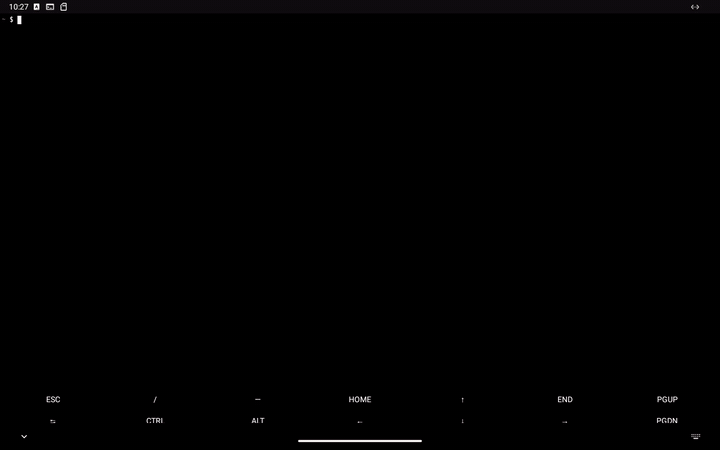
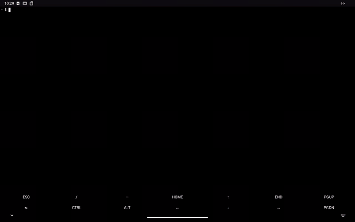
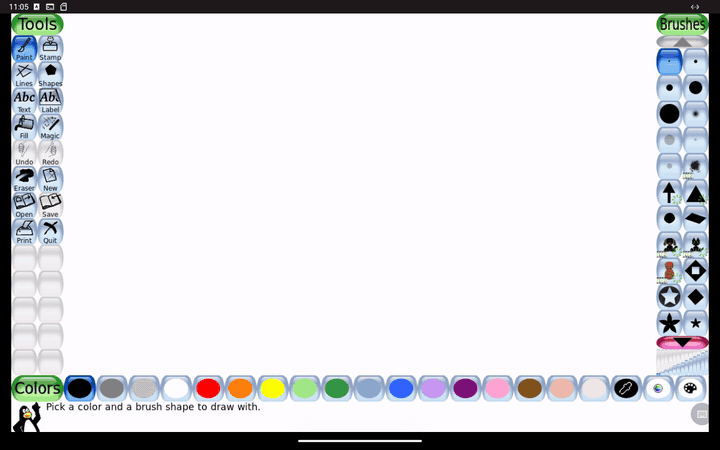

<p align="center"></p>

<h1 align="center">Lindroids</h1>

<p align="center"><b>Linux apps in Android windows.</b><br>
Run any Linux GUI program from Termux, a proot distro or Flatpak as a real Android window — with
sound, touch, the keyboard, the clipboard and your files — and put it on the home screen with its
own icon, where it keeps working with the terminal closed.</p>

```sh
lindroids run galculator          # opens as an Android window
lindroids export mousepad         # adds a home screen icon that works without Termux
```

<p align="center">


</p>

<p align="center"><sub>Left: <code>lindroids run galculator</code> in Termux. Right: <code>lindroids export mousepad</code>,
then Termux is closed and Mousepad starts from its own icon. Recorded on Android 13 (x86_64);
full-quality videos: <a href="media/demo-run.mp4">run</a>, <a href="media/demo-export.mp4">export</a>.</sub></p>

<p align="center">

</p>

<p align="center"><sub><code>lindroids run org.tuxpaint.Tuxpaint</code>: Tux Paint from Flathub, installed with
<code>flatpak</code> inside a proot-distro Debian, running without bubblewrap, drawn with touch, with its
sound effects playing through Android (<a href="media/demo-flatpak.mp4">video</a>).</sub></p>

## What it does

- **Every Linux window is an Android window.** Each toplevel gets its own Android task: it shows
  up in Recents with its name and icon, works in split screen and in freeform/desktop mode, and
  Android's compositor draws it. Menus, popups and dialogs work; windows that insist on being
  larger than the screen are scaled down to fit instead of cut off.
- **Anything with a window.** Native Termux packages (GTK, Qt, SDL, foot, mpv…), programs in a
  proot distro (`--distro debian`), installed **Flatpaks** (run without bubblewrap, which cannot
  work inside an Android app), and X11-only programs (`--x11`, under Xwayland with a built-in
  window manager).
- **Sound.** A PulseAudio-compatible server plays every stream through Android (AAudio, or
  AudioTrack on Android 7): paplay, GStreamer, SDL, ALSA via pulse, libcanberra.
- **Input.** Touch (as touch, or as a mouse for apps that don't do touch), mouse, hardware
  keyboards, and the Android soft keyboard with any language through text-input-v3. The clipboard
  is shared both ways.
- **Files.** Shared storage (`/sdcard`) for exported apps, and `lindroids pick-folder` opens
  Android's folder picker and prints the path.
- **Home screen shortcuts.** `lindroids export <command>` copies the program and exactly the
  packages it needs into the Lindroids app, and pins a shortcut with the program's own icon.
  Tapping it runs the program inside the app — Termux does not need to be running, or even
  installed. (`--link` makes a lightweight shortcut that starts it through Termux instead.)
- **Pure Rust** where it matters: the compositor, the sound server, the CLI, the frame transport,
  packaging logic. Java is only the thin layer Android insists on (activities, the service).

## Install

In **Termux** (from F-Droid or GitHub):

```sh
curl -fsSL https://dixonsolutions.github.io/lindroids/install.sh | sh
lindroids setup        # installs the Lindroids app, then pairs it with this terminal
```

This adds the Lindroids APT repository, so `pkg upgrade` keeps both the CLI and the app current
(the package carries the matching APK). The same line works in **Debian/Ubuntu under proot**
(proot-distro, UserLAnd, Andronix) and on desktop Linux; anywhere else it installs a static
binary. The app alone is on the [releases page](https://github.com/dixonSolutions/lindroids/releases/latest).
Details: [docs/INSTALL.md](docs/INSTALL.md).

The first time, the app asks for the 6-digit pairing code that `lindroids setup` (or
`lindroids pair`) shows in the terminal. After that they find each other on their own.

## Use

```sh
lindroids run <command> [args]          # run a program; its windows open as Android windows
lindroids run "foot -e htop"            # a whole command line
lindroids run --distro debian gedit     # from a proot-distro distro
lindroids run org.gnome.Calculator      # an installed Flatpak (in Termux or any distro)
lindroids run --x11 xterm               # an X11-only program
lindroids run --name "Notes" --icon notes.svg mousepad

lindroids export <command> [args]       # home screen shortcut; runs without Termux
lindroids export --link <command>       # lightweight shortcut that starts it through Termux
lindroids list                          # what you exported from here
lindroids remove <id>

lindroids pick-folder                   # Android's folder picker; prints the chosen path
lindroids status | doctor | pair | setup | start | stop | version
```

Useful environment: `LINDROIDS_SCALE=2` (output scale; default follows the screen density),
`LINDROIDS_TOUCH=pointer` (touch drives a mouse pointer instead of touch events).

## How it works

```
 Termux / proot distro / Flatpak                         Lindroids app (Android)
 ┌────────────────────────────────────┐                  ┌───────────────────────────────┐
 │ Linux programs                      │                  │ one Activity per Linux window │
 │   │ Wayland    │ PulseAudio  X11    │                  │   SurfaceView ← changed tiles │
 │   ▼            ▼             ▼      │   link: unix     │   touch, keys, IME, clipboard │
 │ lindroids server ◀── Xwayland       │◀═══ socket or ═══▶│   AAudio / AudioTrack         │
 │  (Rust Wayland compositor +         │   loopback TCP   │   shortcuts, folder picker    │
 │   sound server, plain Linux)        │   (HMAC auth)    │   in-app server + proot for   │
 └────────────────────────────────────┘                  │   exported bundles            │
                                                         └───────────────────────────────┘
```

- `lindroids` is one binary: the CLI, and the server (`lindroids server`), which it starts on
  demand. The server is a plain Linux program — no Android APIs, no `app_process` — so it runs in
  any sandbox. It composites each window on the CPU and sends only the 64×64 tiles that changed,
  LZ4-compressed, one frame in flight per window; the app copies them into the window's Surface.
- Android does not let one app connect to another app's Unix sockets (SELinux), but any two apps
  may talk over loopback TCP, so that is the link everywhere except where the abstract socket is
  allowed. Both sides prove they know a shared secret (HMAC-SHA256 over each other's nonce); the
  first pairing uses a one-time code shown in the terminal, so no other app can watch your windows
  or type into your terminal.
- An exported bundle is a tar stream of the program's dpkg closure (plus its plugins: pixbuf
  loaders, GIO/GTK modules…) sent over the link into the app's storage. The app runs it under the
  proot it ships, against a server running inside the app itself. Flatpaks export as their
  runtime + app + extensions.

More: [docs/ARCHITECTURE.md](docs/ARCHITECTURE.md).

## Compatibility

| | |
|---|---|
| Android | 7.0 (API 24) and newer; arm64-v8a, armeabi-v7a, x86_64, x86 |
| Terminals | Termux; Debian/Ubuntu under proot (proot-distro, UserLAnd, Andronix…); desktop Linux (for testing) |
| Tested apps | GTK 3 (Galculator, Mousepad), GTK 4 (widget factory; GNOME Calculator, Characters and Pinta as Flatpaks), SDL 3 (Tux Paint Flatpak from Flathub, on Android), Flutter (RustDesk Flatpak), foot, xterm (X11), paplay/GStreamer/SDL/ALSA sound |
| Should work, not yet tested | Qt 5/6 on Wayland, SDL games, Firefox/Chromium/Electron on Wayland |

Tested versions are listed in [lab/README.md](lab/README.md), with the QEMU lab that runs them.

## Build from source

```sh
scripts/build-release.sh          # everything: CLIs for 8 targets, APK, debs, tarballs → dist/
cargo test --workspace --exclude lindroids-android
tests/host-integration.sh         # server + a stand-in app + foot, on any Linux box
```

Needs Rust with the Android and musl targets, `cargo-ndk`, the Android SDK (build-tools 35,
platform 35) and NDK 27, and a JDK. No Gradle. See [docs/PACKAGING.md](docs/PACKAGING.md).

## License

Lindroids is dual-licensed under [MIT](LICENSE-MIT) or [Apache-2.0](LICENSE-APACHE), at your
option. The APK also ships Termux's builds of proot (GPL-2.0), talloc (LGPL-3.0) and
libandroid-shmem (BSD-3-Clause); see [third_party/README.md](third_party/README.md).
