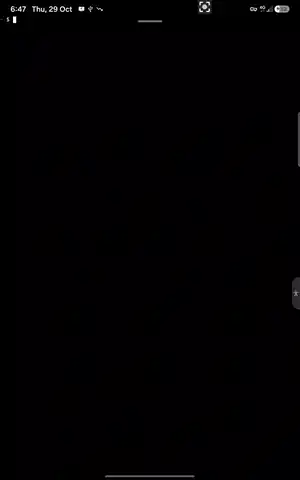
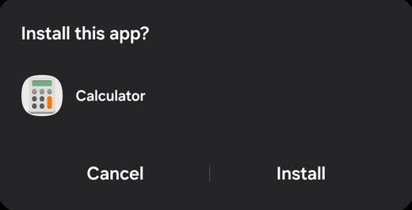
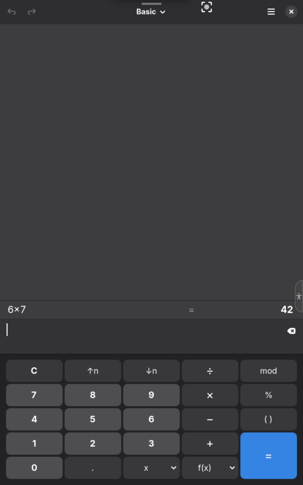
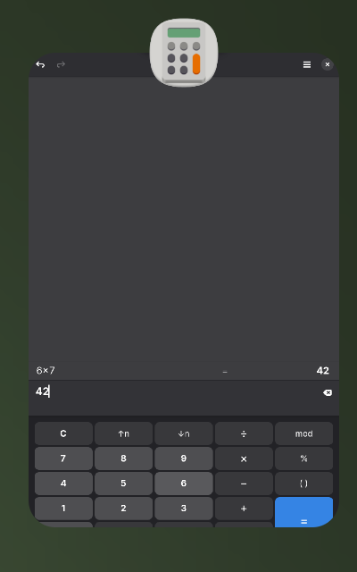
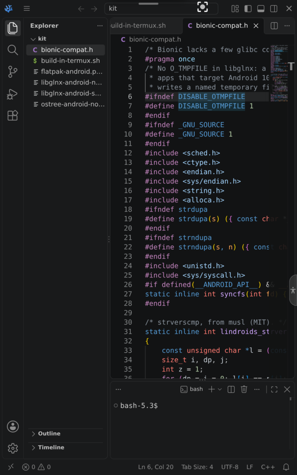

<p align="center"></p>

<h1 align="center">Lindroids</h1>

<p align="center"><b>Linux apps on Android, each one an app of its own.</b><br>
Run Linux GUI programs from Termux, a proot distro or Flathub. <code>lindroids export</code> turns a
program into a real Android app, with its name and icon in the app list and Recents, built on the
phone in milliseconds. No root, no browser, nothing to download.</p>

<p align="center"><a href="https://discord.gg/aWQwxV4wm"></a></p>

<p align="center"><br>
<sub>45 seconds on a Galaxy Tab (Android 16): <code>lindroids run</code>, then <code>lindroids export</code> builds Calculator its own app, which starts from its icon. <a href="media/demos/export-and-run.mp4">mp4</a></sub></p>

<table>
<tr>
<td align="center" width="33%"><br><sub><code>lindroids export</code> builds the app on the phone; Android installs it</sub></td>
<td align="center" width="33%"><br><sub>GNOME Calculator in its own app: full screen, no browser</sub></td>
<td align="center" width="33%"><br><sub>Recents shows the program's own icon</sub></td>
</tr>
<tr>
<td align="center" colspan="3"><br><sub>VSCodium from Flathub, in its own app on a Galaxy Tab (Android 16)</sub></td>
</tr>
</table>

```sh
curl -fsSL https://dixonsolutions.github.io/lindroids/install.sh | sh   # in Termux
lindroids run org.gnome.Calculator         # a window of its own, now
lindroids export org.gnome.Calculator      # an app of its own: tap Install, then its icon
```

## What you get

- **Every exported program is an Android app.** `lindroids export` builds an APK for the
  program on the phone (its package, name, icon and start page; about 180 KB, in milliseconds)
  and hands it to Android's installer. Its icon starts the program, also when Termux is not
  running; its window is Android's own WebView, full screen; Recents shows its icon.
  [How, and what was tested →](docs/APPS.md)
- **Single runs get a window of their own too.** `lindroids run` opens the program in the
  Lindroids windows app (`lindroids app install` builds it on the phone, once): one window per
  run with the program's name, closed when the program ends or Termux stops. One UI draws the
  windows app's icon on those cards; only an exported program's own app shows its own.
- **Any Linux program with a window**: Termux packages, programs in a proot distro, Flatpaks
  from Flathub (set up in Termux by `install.sh`, no root), X11 programs.
- **Android underneath**: dark mode and accent colour, Android's file picker for *Open…* and
  *Save As…*, *Open with* from the Files app, notifications, the clipboard both ways, sound and
  the microphone, keeping the screen on, battery state, touch, pen and keyboards.

## How it works

```
 Termux / proot distro / Flatpak                         Android
 ┌────────────────────────────────────┐                  ┌──────────────────────────────────┐
 │ Linux programs                     │                  │ the program's own app (WebView)  │
 │   │ Wayland │ PulseAudio │ X11     │◀═ WebSocket on ═▶│   canvas, touch, keys, sound     │
 │ lindroids server + desktop portals │   loopback,      │   file pickers, clipboard        │
 │ app_process helper (as Termux) ────┼── P-256 keys ───▶│ installer, notifications, theme  │
 └────────────────────────────────────┘                  └──────────────────────────────────┘
```

- **The program and its data stay in Termux** (or the proot distro, or the Flatpak). The
  `lindroids` server is a Wayland compositor and a PulseAudio server in one Rust binary; it
  sends each window as a page on a loopback port, tile by tile, and takes back input.
- **The window is an app on Android.** Android draws windows only for installed apps, so each
  exported program gets one: the window app's code (`packaging/webview-app`) under the program's
  identity, filled in and signed on the phone by `crates/lindroids-apk` (no Android SDK, aapt or
  Java there). Programs that are not exported open in a browser Custom Tab, or in the optional
  shared app (`lindroids app install`).
- **Android's side reaches programs through the desktop portals** (Settings, FileChooser,
  OpenURI, Notification, Inhibit), so GTK and libadwaita programs follow it unchanged.

More: [docs/ARCHITECTURE.md](docs/ARCHITECTURE.md), [docs/DISPLAY.md](docs/DISPLAY.md).

## Install

In **Termux** (from F-Droid, GitHub or Google Play):

```sh
curl -fsSL https://dixonsolutions.github.io/lindroids/install.sh | sh
```

`install.sh` adds the Lindroids repository to the package manager (Termux's APT or pacman;
Debian/Ubuntu, Arch, Fedora, openSUSE, Alpine, Void in proot distros and on desktops), so the
usual upgrade keeps it current, and offers to set up Flatpak. Details:
[docs/INSTALL.md](docs/INSTALL.md).

The first `lindroids export` asks Android once to allow installs: from Termux (F-Droid/GitHub
Termux), or from the file manager (Google Play Termux, which may not install apps itself).
Google Play Protect may then ask to scan the new app; *More details → Install without scanning*
keeps it on the phone.

## Use

```sh
lindroids run <command> [args]           # a program in a window of its own
lindroids run org.gnome.TextEditor       # a Flatpak
lindroids run --prootdistro=debian gedit # from a proot-distro distro
lindroids export <command> [args]        # an app of its own (again: updates it)
lindroids list | launch <id> | remove <id>
lindroids open --linux <file>            # a file in a Linux program; `open <file|URL>` in Android
lindroids notify <title> [body]          # an Android notification
lindroids status | doctor | stop | version
```

`lindroids config browser` chooses what an export becomes: `app` (the default, its own app),
`webapk` (an app made by Chrome or Samsung Internet, [docs/WEBAPK.md](docs/WEBAPK.md)),
`home-screen` (a Termux shortcut) or a browser.

## Limits

- Installing is always the user's tap in Android's installer, and new apps meet Google Play
  Protect. From 2027, Google's developer verification may require a one-time "advanced flow"
  for apps signed on the phone ([BROWSER_AGNOSTIC_APK.md](BROWSER_AGNOSTIC_APK.md)).
- An app is signed with a key made on the phone: clearing Termux's data loses it, and the apps
  must then be uninstalled before they can be installed again.
- Windows of programs that are not exported open in a browser: there full screen starts on the
  first tap, and Firefox shows its own icon in Recents.

## Tested

On a Samsung Galaxy Tab Active5 (Android 16, Termux from Google Play): building, installing and
updating VSCodium's app, starting it from its icon with Termux closed, one window in Recents with
VSCodium's icon ([docs/APPS.md](docs/APPS.md)). On Android 13 lab VMs: Calculator, Text Editor,
Mousepad, foot, Xournal++, X11 programs, home screen icons after a reboot, Open with, the file
picker, notifications, theme ([docs/TESTING.md](docs/TESTING.md), [lab/CHECKLIST.md](lab/CHECKLIST.md)).

## Build from source

```sh
cargo test --workspace
scripts/build-release.sh               # CLIs for 8 targets and every package → dist/
packaging/build-app-template.sh        # after changing packaging/webview-app (needs the SDK)
```

Needs Rust with the Android and musl targets, `cargo-ndk` and NDK 27:
[docs/PACKAGING.md](docs/PACKAGING.md).

## License

[MIT](LICENSE-MIT) or [Apache-2.0](LICENSE-APACHE), at your option. Packages also ship
xwayland-satellite (MPL-2.0): [third_party/README.md](third_party/README.md).
